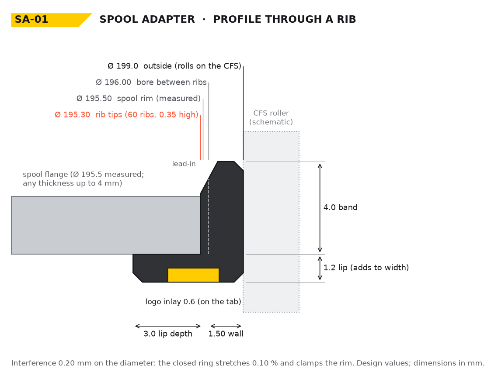
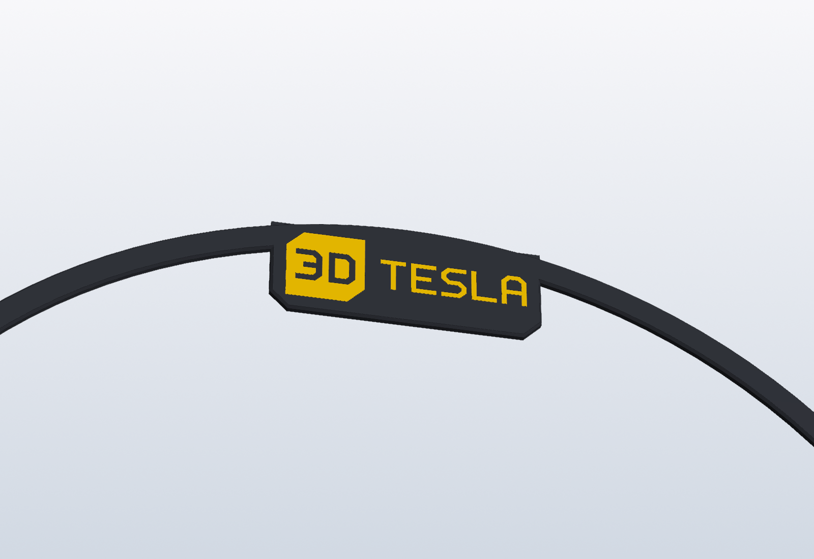
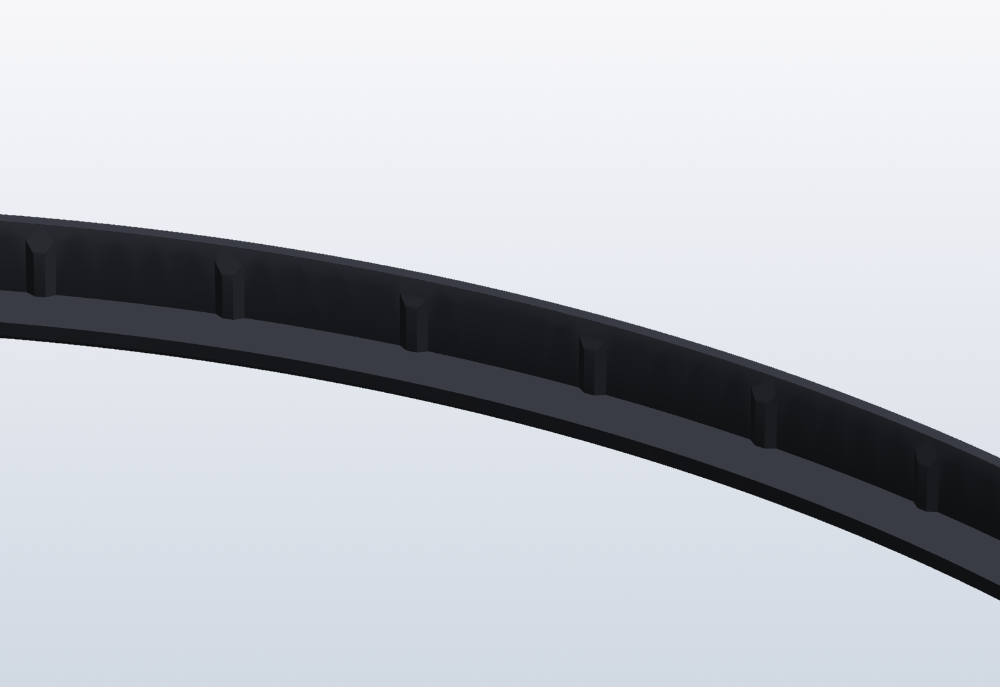

# SA-01 — Spool Adapter

**A press-fit ring that brings a 195.5 mm filament spool up to 199 mm, so it runs in the Creality Filament
System (CFS) without slipping.** Two rings per spool, one on each flange; printed in two colours with the 3DTesla
logo on a small tab; no screws, no glue.


> **Status: v0.1.0 (2026-11-24), designed and checked in CAD, not printed yet.** The two spool diameters are
> measured; every other number is a design value or an estimate. See the [changelog](CHANGELOG.md).

## Why

The CFS holds each spool on rollers that touch the rims of its flanges. Creality lists spools of **197–202 mm**
for the CFS and warns that a spool that is too small can slip and turn unsteadily, which breaks retraction
([compatibility](https://wiki.creality.com/en/cfs/cfs-filament-compatibility),
[precautions](https://wiki.creality.com/en/cfs-2/supported-filaments-precautions)). Filamentor spools measure
**195.5 mm**; the Creality spools that run well measure **199 mm**. SA-01 adds the missing 1.75 mm all round.

## How it holds



- **A closed ring**: the band that wraps the rim is the new rolling surface, Ø 199.0 mm, smooth and with no
  joint for the rollers to bump over.
- **Press fit with crush ribs**: 60 small axial ribs inside the band are 0.20 mm (on the diameter) tighter than
  the rim. The ring stretches 0.10 % when pressed on and clamps the rim all round: an estimated 4 N·m before it
  could turn, more than ten times what the CFS needs ([design.md §5](docs/design.md#5-retention-estimates)).
- **A lip on the outer face** stops the ring at the right place and is the only width it adds: **1.2 mm per side**
  (the CFS accepts spools up to 68 mm wide). Nothing reaches inside the rim on the filament side.
- **A lead-in** on the ribs and the bore guides the ring onto the rim.
- **Any flange up to 4 mm thick** is gripped over its whole thickness.

| Outer face with the logo | Crush ribs and lead-in | Section on the flange |
|---|---|---|
|  |  |  |

## Print it

Download [`3mf/SpoolAdapter_195.5-to-199mm_2color.3mf`](3mf/SpoolAdapter_195.5-to-199mm_2color.3mf).

1. Open it in Creality Print (or OrcaSlicer, Bambu Studio, PrusaSlicer). It loads as **one object with two
   parts**: `SpoolAdapter` (the ring) and `SpoolAdapter_logo`. Give the ring your dark filament (graphite) and the
   logo the second colour (yellow). The colours in the file are only a hint.
2. Keep it as it comes: **lip on the plate**. The logo is in the first 3 layers, on the face against the plate, so
   the CFS changes colour on those 3 layers only.
3. Settings: 0.4 mm nozzle, **0.2 mm layers including the first**, 4 walls, no supports, **no brim**.
   PETG is preferred, PLA works. About 10 g per ring (estimate).
4. **Print two**, one for each flange (one ring per plate: 199 mm fits the 260 × 260 mm bed of the Creality Hi).


## Fit it

1. Lay a ring on the table, logo down.
2. Set the spool on it so the flange's rim enters the band, and press down evenly all round (or start at one side
   and work round the circumference) until the flange rests on the lip everywhere.
3. Turn the spool over and fit the second ring on the other flange.
4. Check: the ring must not turn on the rim by hand. The spool with both rings must be at most 68 mm wide.

To remove it, push the band off the rim from the filament side, a little at a time round the circumference.

**If the fit is wrong**, reprint with X and Y scaled in the slicer (Z stays 100 %); each 0.1 % changes the
diameters by about 0.2 mm and the outside stays well inside the CFS range:

| Fit | Scale X/Y | Outside diameter |
|---|---|---|
| loose, turns by hand | 99.8 % | 198.6 mm |
| too hard to press on | 100.2 % | 199.4 mm |

## Another spool

The model is parametric (CadQuery). For a spool of another size, measure its flange diameter and build:

```bash
python -m venv .venv
.venv\Scripts\python -m pip install -r cad\requirements.txt      # Windows; .venv/bin/python on Linux/macOS
cd cad
..\.venv\Scripts\python build.py                                  # checks, the 3MF, the renders
..\.venv\Scripts\python build.py --rim 194.8 --od 199             # another spool: checks + its own 3MF
..\.venv\Scripts\python build.py --interference 0.3 --no-render   # a tighter fit
```

The build checks the diameters, the fit, the wall, the ribs, the bed fit, the logo's strokes and margins and the
meshes before it writes the 3MF ([design.md §9](docs/design.md#9-automatic-checks-python-buildpy)).

## Repository

| Path | What |
|---|---|
| `3mf/` | the two-colour 3MF, ready to slice |
| `cad/spool_adapter.py` | parameters, geometry and design checks |
| `cad/logo.py` | the 3DTesla logo, from the brand SVG |
| `cad/build.py` | build: checks, 3MF, renders, the dimensioned profile |
| `cad/export3mf.py`, `cad/render.py` | 3MF writer with mesh checks; VTK renders |
| `docs/design.md` | the design: requirements, concept and alternatives, parameters, retention estimates, check items |
| `docs/img/` | renders and the profile drawing (generated) |

## Licence

[MIT](LICENSE) for the model, the code and the documentation. The 3DTesla name and logo are not covered by the
licence.
