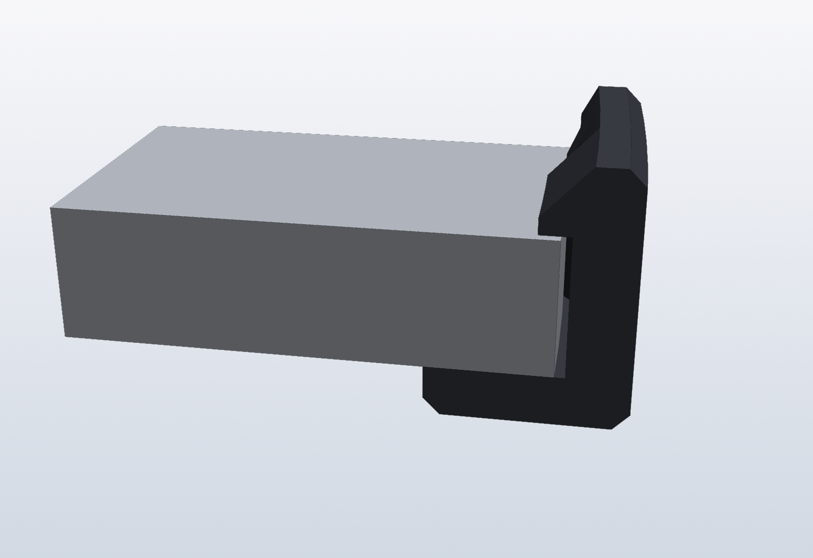
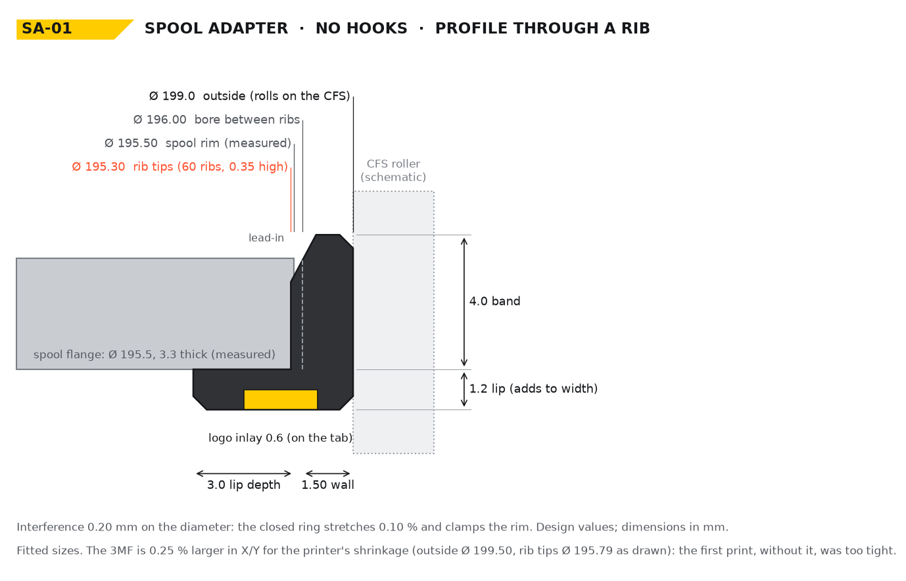
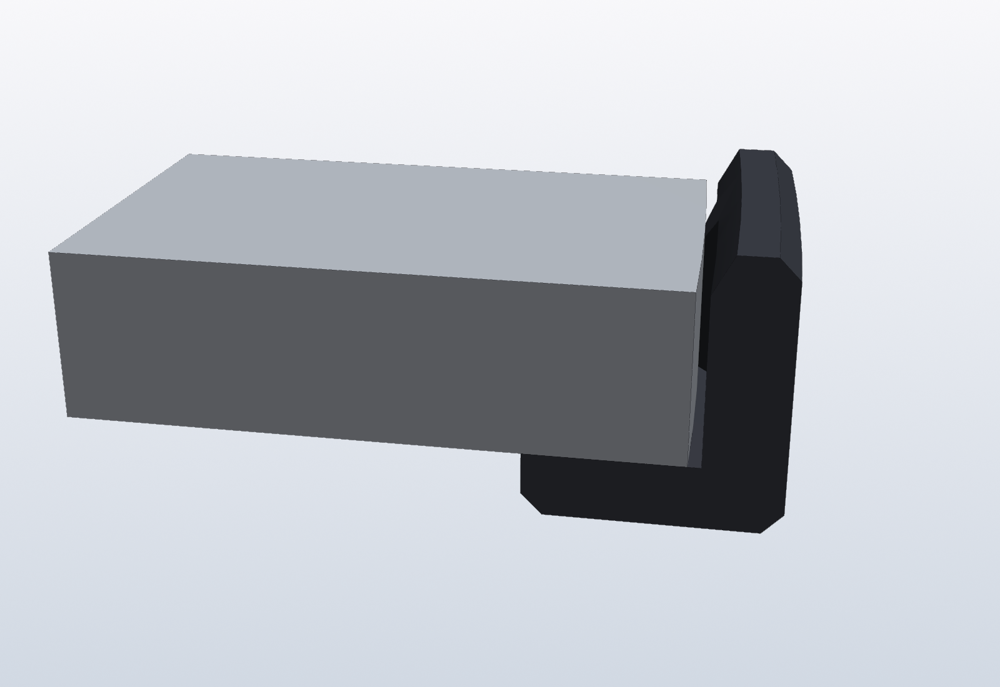
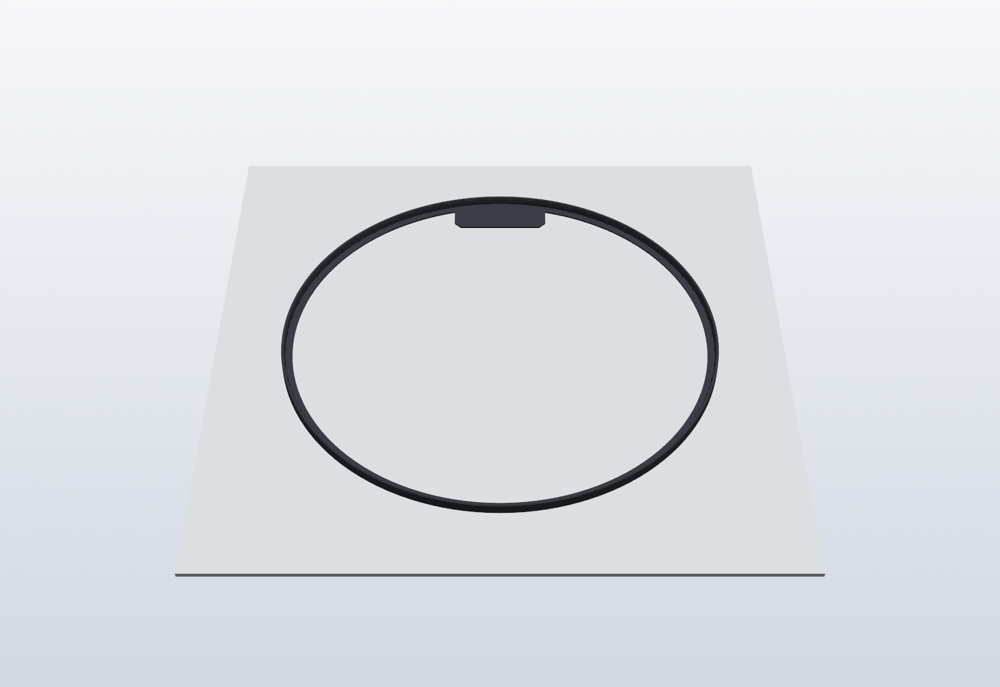

# SA-01 — Spool Adapter

**A press-fit ring that brings a 195.5 mm filament spool up to 199 mm, so it runs in the Creality Filament
System (CFS) without slipping.** Two rings per spool, one on each flange; printed in two colours with the 3DTesla
logo on a small tab; no screws, no glue. Two versions: **with five small hooks** that click behind the flange, or
**without hooks**, 1 mm shorter.


> **Status: v1.2.1 (2026-11-25): both versions printed and confirmed.** With hooks: the v1.0.0 file, 0.25 % larger
> in X/Y for the printer's shrinkage. Without hooks: the v0.2.0 ring written 0.35 % larger in X/Y for an easier
> fit (v1.2.0), printed and OK. The spool's diameter and flange thickness are measured; every other number
> (forces, torque, mass) is a design value or an estimate. See the [changelog](CHANGELOG.md).

## Two versions

| | With hooks (default) | Without hooks |
|---|---|---|
| File | [`SpoolAdapter_195.5-to-199mm_2color.3mf`](3mf/SpoolAdapter_195.5-to-199mm_2color.3mf) | [`SpoolAdapter_195.5-to-199mm_no-hooks_2color.3mf`](3mf/SpoolAdapter_195.5-to-199mm_no-hooks_2color.3mf) |
| Height (lip + band) | 6.2 mm (1.2 + 5.0) | 5.2 mm (1.2 + 4.0) |
| Holds by | crush ribs + five snap hooks behind the flange: it cannot walk off | crush ribs only (friction) |
| Fit and removal | one side first, each hook clicks; removal one hook at a time | pressed on evenly; pushed off from the filament side |
| File scale in X/Y | +0.25 % (Ø 199.50 outside, rib tips Ø 195.79 as drawn) | +0.35 %, a little looser (Ø 199.70, tips Ø 195.98) |
| Mass (estimate) | about 11 g per ring | about 10 g per ring |
| Printed | v0.3.0 = v1.0.0: "Ficou bom" | v1.2.0 at +0.35 %: "Tudo impresso e ok" (v0.2.0 at +0.25 %: "O tamanho ficou bom") |

Same model diameters (199.0 mm outside), same ribs, lip, tab and logo; the band's length, the hooks and the scale
of the file differ.

## Why

The CFS holds each spool on rollers that touch the rims of its flanges. Creality lists spools of **197–202 mm**
for the CFS and warns that a spool that is too small can slip and turn unsteadily, which breaks retraction
([compatibility](https://wiki.creality.com/en/cfs/cfs-filament-compatibility),
[precautions](https://wiki.creality.com/en/cfs-2/supported-filaments-precautions)). Filamentor spools measure
**195.5 mm**; the Creality spools that run well measure **199 mm**. SA-01 adds the missing 1.75 mm all round.

## How it holds


- **A closed ring**: the band that wraps the rim is the new rolling surface, Ø 199.0 mm, smooth and with no
  joint for the rollers to bump over.
- **Press fit with crush ribs**: 60 small axial ribs inside the band are 0.20 mm (on the diameter) tighter than
  the rim. The ring stretches 0.10 % when pressed on and clamps the rim all round: an estimated 5 N·m before it
  could turn, more than ten times what the CFS needs ([design.md §5](docs/design.md#5-retention-estimates)).
- **A lip on the outer face** stops the ring at the right place and is the only width it adds: **1.2 mm per side**
  (the CFS accepts spools up to 68 mm wide). Nothing reaches inside the rim on the filament side.
- **Five snap hooks** on the band's inner edge, one every 72° (the logo tab midway between two), reach 0.5 mm
  behind the rim and click over the flange's inner face, 0.1 mm above the measured 3.3 mm flange. Flat catch
  face: the ring cannot walk off the spool. Each hook is 6 mm wide, and they touch the flange only within 0.5 mm of
  the rim, clear of the filament.
- **A lead-in** on the ribs and a 45° ramp on each hook guide the ring onto the rim.

| Outer face with the logo | Snap hook between the crush ribs | Section: the flange held by a hook |
|---|---|---|
|  |  |  |

**Without hooks** the band ends 0.7 mm past the flange's inner face and only the ribs hold the rim (they press on
it over 2.8 of the 3.3 mm flange; above that is the lead-in):

| Profile without hooks | Section without hooks, at the same place |
|---|---|
|  |  |

## Print it

Download the version you want from [`3mf/`](3mf/) (table above), or from the
[latest release](https://github.com/icefoxj/SpoolAdapter/releases/latest). Both print the same way.

1. Open it in Creality Print (or OrcaSlicer, Bambu Studio, PrusaSlicer). It loads as **one object with two
   parts**: `SpoolAdapter` (the ring) and `SpoolAdapter_logo`. Give the ring your dark filament (graphite) and the
   logo the second colour (yellow). The colours in the file are only a hint.
2. Keep it as it comes: **lip on the plate**, **scale 100 %**. The file is deliberately 0.25 % larger in X and Y
   than the fitted ring (Ø 199.5 mm outside as drawn) because large printed rings shrink; the print comes out at
   about 199 mm. The version without hooks is 0.35 % larger (Ø 199.7 mm as drawn), for an easier fit. The logo is in the first 3 layers, on the face against the plate, so
   the CFS changes colour on those 3 layers only.
3. Settings: 0.4 mm nozzle, **0.2 mm layers including the first**, 4 walls, no supports, **no brim**.
   PETG is preferred, PLA works. About 11 g per ring with hooks, 10 g without (estimates). The hooks' flat
   undersides are short (0.75 mm) and print without supports.
4. **Print two**, one for each flange (one ring per plate: 199 mm fits the 260 × 260 mm bed of the Creality Hi).



## Fit it

1. Lay a ring on the table, logo down.
2. Set the spool on it so the flange's rim enters the band. **Start at one side**: press until the first two
   hooks click behind the flange, then work round the circumference, pressing down the opposite side last; the ring
   flexes and each hook clicks in turn. Pressing all five over at once is much harder.
3. Check that the flange rests on the lip all round and that all five hooks sit behind it.
4. Turn the spool over and fit the second ring on the other flange.
5. Check: the ring must not turn on the rim by hand. The spool with both rings must be at most 68 mm wide.

To remove it, lift one hook at a time from the filament side (a fingernail or a small flat screwdriver) while
pulling that part of the ring off, then work round to the next.

**Without hooks**: in step 2 press down evenly all round (or start at one side and work round) until the flange
rests on the lip everywhere; skip the hook check in step 3. To remove it, push the band off the rim from the
filament side, a little at a time round the circumference.

**If the fit is wrong**, reprint with X and Y scaled in the slicer (Z stays 100 %); each 0.1 % changes the
diameters by about 0.2 mm and the outside stays well inside the CFS range (197–202 mm):

| Fit | Scale X/Y | Same as rebuilding with |
|---|---|---|
| loose, turns by hand | 99.9 % | `--comp 0.15` (with hooks), `--comp 0.25` (without) |
| still too hard to press on | 100.1 % | `--comp 0.35` (with hooks), `--comp 0.45` (without) |

`--comp` sets the scale of both versions; the defaults are 0.25 % with hooks and 0.35 % without.

## Another spool

The model is parametric (CadQuery). For a spool of another size, measure its flange diameter and its flange
thickness at the rim, and build:

```bash
python -m venv .venv
.venv\Scripts\python -m pip install -r cad\requirements.txt      # Windows; .venv/bin/python on Linux/macOS
cd cad
..\.venv\Scripts\python build.py                                  # both versions: checks, 3MFs, renders
..\.venv\Scripts\python build.py --variant no-hooks               # only one version (hooks | no-hooks)
..\.venv\Scripts\python build.py --rim 194.8 --flange 2.5         # another spool: checks + its own 3MFs
..\.venv\Scripts\python build.py --comp 0.35 --no-render          # looser: more shrinkage compensation
```

The build checks the diameters, the fit, the wall, the ribs, the hooks (position over the flange, a free seat for
the flange, printability) or, without hooks, that the band covers the flange and nothing reaches inside the rib
tips, the bed fit, the logo's strokes and margins and the meshes before it writes each 3MF ([design.md §9](docs/design.md#9-automatic-checks-python-buildpy)).

## Repository

| Path | What |
|---|---|
| `3mf/` | the two-colour 3MFs (with hooks, without hooks), ready to slice |
| `cad/spool_adapter.py` | parameters, geometry and design checks |
| `cad/logo.py` | the 3DTesla logo, from the brand SVG |
| `cad/build.py` | build: checks, 3MF, renders, the dimensioned profile |
| `cad/export3mf.py`, `cad/render.py` | 3MF writer with mesh checks; VTK renders |
| `docs/design.md` | the design: requirements, concept and alternatives, parameters, retention estimates, check items |
| `docs/img/` | renders and the profile drawing (generated) |

## Licence

[MIT](LICENSE) for the model, the code and the documentation. The 3DTesla name and logo are not covered by the
licence.
