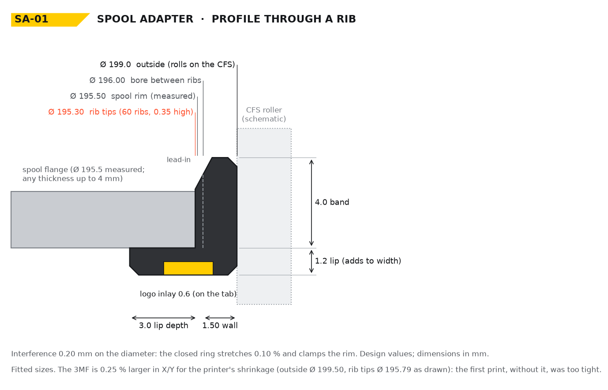

# SA-01 design

The contract for the spool adapter: what it must do, why it looks the way it does, every number and where it
comes from. The CAD (`cad/spool_adapter.py`) implements this page; when one changes, the other changes with it.

**Status (2026-11-25): v1.2.1, two variants, both printed and confirmed by the user.** The size (v0.2.0 print, 3MF
+0.25 % in X/Y, §5) and the five snap hooks behind the flange (v0.3.0 print, §3a) fit. The variant without hooks
(§3b) is the v0.2.0 ring with its 3MF 0.35 % larger in X/Y, a little looser, as the user asked; the v1.2.0 print
is OK. Measured by the user: the two spool diameters and the flange thickness. Everything else is a design value
or an estimate, and says so.

## 1. Problem and requirements

The Creality Filament System (CFS) holds each spool on rollers that touch the rims of its two flanges. Creality
lists spools of **197–202 mm** diameter and **42–68 mm** width for the CFS
([CFS filament compatibility](https://wiki.creality.com/en/cfs/cfs-filament-compatibility)) and warns that a
spool that is too small can slip and turn unsteadily, which breaks retraction
([CFS 2 precautions](https://wiki.creality.com/en/cfs-2/supported-filaments-precautions)).

User requirements (2026-11-24):

| # | Requirement | Source |
|---|---|---|
| R1 | Filamentor spools measure **195.5 mm** and run loose in the CFS; the Creality spools that work measure **199 mm**. Adapt the Filamentor spool to 199 mm. | user, measured |
| R2 | The adapter must hold firmly and **must not slip** on the spool. | user |
| R3 | A small **tab with the 3DTesla logo**, in **two colours**, delivered as a **3MF** (no STL). | user |
| R4 | Public GitHub repository `SpoolAdapter` with README and CLAUDE.md. | user |
| R5 | (2026-11-25, after the size was right) **five small teeth to hold the adapter in place**: hooks that pass the rim and lock behind the flange. Filamentor flange **3.3 mm** thick at the rim. | user, measured |
| R6 | (2026-11-25, after the hooks were right) **also a ring of the same size without the teeth, as thick as the version before the hooks** (v0.2.0: 5.2 mm overall). | user |
| R7 | (2026-11-25) **the ring without hooks "a little wider", "pouca coisa"**: confirmed as an easier (looser) fit on the rim. | user |

Derived requirements:

| # | Requirement | Why |
|---|---|---|
| D1 | The rolling surface is a smooth, continuous cylinder, Ø 199.0 mm, with no joint or step. | the CFS rollers run on it every rewind |
| D2 | Add as little width as possible: **1.2 mm per side** (2.4 mm per spool). | the CFS accepts at most 68 mm |
| D3 | Nothing may reach more than 0.5 mm inside the rim on the filament side (only the hooks do, 6 mm wide each). | a full spool's filament comes close to the rim |
| D4 | Printed only, no hardware, no glue. One part, printed twice (one per flange). | simple to make and to fit |
| D5 | Fits the Creality Hi plate (260 × 260 mm) and the logo prints in the first layers (CFS colour change). | house printer |

## 2. Concept

**A closed ring with an L section, pressed onto the rim.** The band wraps the rim and is the new rolling surface;
the lip sits on the flange's outer face and sets the ring's axial position; 60 axial crush ribs on the bore are
0.20 mm (on the diameter) tighter than the rim, so the closed ring stretches 0.10 % and clamps the rim all round.

Why this and not the alternatives:

| Concept | Verdict |
|---|---|
| **Closed press-fit ring (chosen)** | No joint on the rolling surface (D1). The hoop stress of a closed ring clamps the rim evenly: a small interference gives a large grip (§5). One part, no hardware. Fit depends on print accuracy: handled by ribs, a small nominal interference and an XY-scale adjustment (§8). |
| Split C-ring (expand and snap on) | A gap on the rolling surface, and the open ring is so flexible that it clamps almost nothing: it would slip (R2). |
| U-channel ring gripping both faces | Cannot go onto a solid flange in one piece; in segments it has joints on the rolling surface; its inner lip reaches inside the rim on the filament side (D3); it needs the flange thickness, which is not measured. |
| Clip-on segments | Joints and steps on the rolling surface (D1), several parts to align. |
| Ring with a clamping screw | Grips well, but needs hardware and leaves a bump at the clamp (D1, D4). |
| Plain ring held by glue or tape | Not removable, messy, and tape adds thickness unevenly. |

From v0.3.0 five snap hooks on the band's inner edge lock the flange between them and the lip (R5), so the band
length follows the measured flange thickness (3.3 mm): the ribs grip the whole flange, the hooks click over its
inner face. For a spool with another flange, rebuild with `--flange` (§8). From v1.1.0 the ring without hooks
(R6) is a second variant of the same model (`HOOKS = False`, §3b), built and checked alongside.

## 3. Geometry

Design frame = print pose: the ring's axis is Z, the lip lies on the bed (z = 0 … 1.2 mm), the flange sits on it
(z = 1.2 … 4.5 mm), the band rises to z = 6.2 mm. Mounted, the bed face is the outer face of the spool and carries
the logo.

- **Band**: Ø 199.0 outside, Ø 196.00 bore, 1.50 mm wall, 6.2 mm long including the lip (5.0 mm past it).
  Outside edges chamfered 0.4 mm.
- **Crush ribs**: 60, axial, one every 6°, 0.35 mm high, 0.6 mm flat tip, 1.6 mm base; tips on Ø 195.30. They are
  centred between the 6° marks so that none falls on the tab's centre line.
- **Lead-in**: one cone through the rib tips 1.4 mm below the entry edge and 0.4 mm outside the bore at the edge:
  the ribs ramp up and the bore gets its entry chamfer in the same cut.
- **Lip**: 1.2 mm thick, reaches 3.0 mm inside the rim (to Ø 189.5) on the flange's outer face. Its inner edge and
  the tab outline are chamfered 0.4 mm on the bed face.
- **Logo tab**: 45 mm wide, reaching 14.25 mm beyond the lip (inner edge 17.25 mm inside the rim), 45° cut corners, same 1.2 mm
  thickness, centred on +Y; its sides run up into the band and it is clipped to the bore, so it never reaches the
  rolling surface. It carries the logo and gives a place to push or pull when fitting or removing.
- **Logo**: 40.0 × 13.0 mm, inlaid 0.6 mm into the bed face, mirrored in the model so that it reads correctly from
  outside, letter tops towards the rim.

### 3a. Snap hooks (v0.3.0)

- **Five**, one every 72°, at 54°, 126°, 198°, 270° and 342°: the logo tab (90°) sits midway between two of them.
  Each sits between two ribs.
- **Catch**: a flat face at z = 4.6 mm = lip 1.2 + flange 3.3 + 0.1 mm clearance (rounded up to a 0.2 mm layer
  boundary). Flat, so pulling the ring does not cam the hook out: the ring cannot walk off the spool.
- **Reach**: the tip is 0.5 mm inside the rim (Ø 194.50 fitted), 6 mm wide, with a 0.4 mm straight land above the
  catch.
- **Ramp**: from the land to the band's entry edge at 44° from the axis; it is the lead-in that lifts each hook
  over the rim when the ring is pressed on.
- **Printing**: the catch face is a 0.75 mm flat overhang from the bore (about two lines), printable without
  supports; the ramp faces up.
- **Fitting**: the ring must stretch 0.51 % to pass all five hooks at once, too much to do by hand comfortably.
  Fitted one side first, the closed ring flexes and each hook passes on its own (§ README "Fit it").

### 3b. Variant without hooks (v1.1.0)

`HOOKS = False` (R6): the v0.2.0 ring, built from the same code.

- **Band**: `PLAIN_BAND_L` = 4.0 mm past the lip, 5.2 mm overall; it ends 0.7 mm past the flange's inner face
  (z = 4.5 mm).
- **No hooks**: nothing inside the rib tips above the lip (checked by volume).
- **Grip**: the same 60 ribs, interference, lead-in, lip, tab and logo. The lead-in starts 1.4 mm below the entry
  edge, so the ribs press on the rim from the lip up to z ≈ 4.0 mm, 2.8 of the 3.3 mm flange (checked: at least
  75 %); in the hooks variant the band is 1 mm longer and the ribs cover the whole flange.
- **Axial hold**: friction only, about the press-on force (§5); nothing locks it behind the flange.
- **A little looser (v1.2.0, R7)**: `SpoolAdapter_195.5-to-199mm_no-hooks_2color.3mf` is written 0.35 % larger in
  X/Y (`XY_COMP_NO_HOOKS`), 0.1 % more than the hooks variant and the v0.2.0 print: outside Ø 199.70 and rib tips
  Ø 195.98 as drawn, the tips about 0.2 mm larger on the diameter than in the printed v0.2.0 ring (the step the
  §8 table gives for "still too hard to press on"). The model is unchanged. In v1.1.0 this file had the same
  content as the v0.2.0 file (compared entry by entry). Printed by the user: "Tudo impresso e ok" (§5).

## 4. Parameters

All in `cad/spool_adapter.py`. `M` = measured, `D` = design value, `E` = estimate.

| Name | Value | | Meaning |
|---|---|---|---|
| `RIM_D` | 195.5 mm | M | Filamentor flange outside diameter (user) |
| `OD` | 199.0 mm | M | target outside diameter: the Creality spool that works (user); CFS range 197–202 |
| `INTERFERENCE` | 0.20 mm | D | rib tips vs rim, on the diameter, fitted |
| `XY_COMP` | 0.25 % | D | the 3MF is this much larger in X/Y than the model (print shrinkage); first print without it: too tight. Variant with hooks |
| `XY_COMP_NO_HOOKS` | 0.35 % | D | the same for the variant without hooks: 0.1 % looser, for an easier fit (R7) |
| `RIB_N`, `RIB_H` | 60, 0.35 mm | D | crush ribs |
| `RIB_TIP_W`, `RIB_BASE_W` | 0.6, 1.6 mm | D | rib tip (above one 0.4 mm line) and base |
| `LIP_T` | 1.2 mm | D | lip and tab thickness = width added per side |
| `LIP_DEPTH` | 3.0 mm | D | lip reach inside the rim |
| `FLANGE_T` | 3.3 mm | M | Filamentor flange thickness at the rim (user, 2026-11-25) |
| `HOOK_N`, `HOOK_W` | 5, 6.0 mm | D | snap hooks, width at the tip |
| `HOOK_H` | 0.5 mm | D | hook reach behind the rim |
| `HOOK_CLEAR`, `HOOK_LAND` | 0.1, 0.4 mm | D | catch clearance above the flange; straight land at the tip |
| derived `BAND_L` | 5.0 mm | D | band length past the lip: flange + clearance + land + ramp, rounded up to a layer |
| `HOOKS` | True / False | D | variant: with the hooks (default) or without (R6) |
| `PLAIN_BAND_L` | 4.0 mm | D | band length past the lip without hooks (5.2 mm overall, as v0.2.0) |
| `LEAD_L`, `ENTRY_C` | 1.4, 0.4 mm | D | lead-in |
| `EDGE_C` | 0.4 mm | D | chamfers |
| `LOGO_H` | 13.0 mm | D | logo height (thinnest stroke 0.84 mm) |
| `LIVERY_DEPTH` | 0.6 mm | D | logo inlay depth = 3 layers of 0.2 mm (house standard) |
| `MIN_STROKE` | 0.8 mm | D | thinnest stroke allowed on the bed face |
| `FACE_MARGIN` | 1.0 mm | D | logo kept this far from every edge and chamfer |
| derived bore | Ø 196.00 mm | D | rib tips + 2 × rib height |
| derived wall | 1.50 mm | D | (OD − bore) / 2 |
| mass | 11.1 g per ring (9.8 g without hooks) | E | PETG 1.27 g/cm³, from the CAD volume; two rings per spool |

## 5. Retention (estimates)

Design values: the ring's hoop section, measured on the CAD between two ribs (`hoop_section`, printed by the
build), is 12.8 mm² with hooks (band 1.5 × 6.2 mm plus lip 3.25 × 1.2 mm, less chamfers) and 11.3 mm² without
(band 5.2 mm); printed PETG E ≈ 2.0 GPa; friction PETG on a plastic spool μ ≈ 0.3 (estimate).

| Quantity | With hooks | Without hooks | How |
|---|---|---|---|
| hoop strain when fitted | 0.10 % | 0.10 % | 0.20 / 195.5 |
| hoop stress | 2.0 MPa | 2.0 MPa | E·ε (PETG yields around 50 MPa) |
| hoop force T | 26 N | 23 N | σ × section |
| total clamping force on the rim | 165 N | 145 N | 2π·T |
| torque before the ring turns on the rim | ≈ 4.8 N·m | ≈ 4.3 N·m | μ × clamping force × 97.75 mm |
| torque the CFS needs to turn the spool | ≲ 0.3 N·m | ≲ 0.3 N·m | filament tension of a few newtons × ≤ 86 mm radius (estimate) |
| force to press the ring on | ≈ 50 N (5 kgf) | ≈ 44 N (4.5 kgf) | μ × clamping force (with hooks, plus their snap) |
| axial hold | locked by the hooks | ≈ 44 N | without hooks only friction holds it on the rim |

So the grip has a margin of more than ten against the torque it must carry, at a stress far below anything that
would creep noticeably at room temperature. In PLA (E ≈ 3.5 GPa) every force is 1.75 times larger.

Print accuracy matters more than the material: large FDM parts often come out 0.1–0.3 % small. At 0.2 % small
the interference becomes about 0.59 mm: the press-on force rises to roughly 130 N (13 kgf, still possible by
pressing the spool onto the ring on a table) and the strain to 0.3 %, still elastic. That is why the nominal
interference is small; §8 says how to adjust it.

**First print (v0.1.1, user, 2026-11-25): "muito apertado"** (much too tight), with the 3MF at the model's size.
So the printer's shrinkage plus the usual undersize of printed holes ate more than the 0.20 mm budget. From
v0.2.0 the model stays the fitted ring and the 3MF is written **0.25 % larger in X and Y** (`XY_COMP`; Z untouched,
so the logo stays 0.6 mm): outside Ø 199.50 and rib tips Ø 195.79 as drawn, the tips 0.49 mm looser on the
diameter. The value is a design estimate; the next print confirms it, and a caliper measurement of a printed
ring across two opposite ribs (rib *i* and rib *i* + 30) would pin it down.

**Second print (v0.2.0, user, 2026-11-25): "O tamanho ficou bom"** (the size is right). `XY_COMP` 0.25 % stays.
The hooks of v0.3.0 scale with it, so they keep their 0.5 mm reach behind the printed rim.

**Third print (v0.3.0, user, 2026-11-25): "Impresso. Ficou bom"** (printed, it is good): the ring with the five
hooks fits and holds on the Filamentor spool. Released unchanged as v1.0.0. Not measured: the press-on force, the
torque before the ring turns and the hooks' pull-out force; the numbers above remain estimates.

**Variant without hooks**: in v1.1.0 its 3MF had the same content as the v0.2.0 print. From v1.2.0 it is 0.1 %
looser (R7): the rib tips are about 0.2 mm larger on the diameter than in the v0.2.0 print, so the real
interference, and with it the clamping force, torque and axial hold above, is smaller by an amount that cannot be
given (the v0.2.0 interference was not measured). If the ring turns on the rim or slides off, go back to 0.30 %
or 0.25 % (§8).

**Fourth print (v1.2.0 without hooks, +0.35 %, user, 2026-11-25): "Tudo impresso e ok"** (all printed and OK).
`XY_COMP_NO_HOOKS` 0.35 % stays. Not measured either: the press-on force, the torque and the axial hold.

The ribs make the fit tolerant: the bore between them never touches the rim (0.5 mm clearance on the
diameter), a seam blob or a slightly oval rim only meets a few ribs, and the ribs press into the rim along their
length, which also resists turning.

## 6. Printing

- **One object, two parts** in `3mf/SpoolAdapter_195.5-to-199mm_2color.3mf` (with hooks) and
  `3mf/SpoolAdapter_195.5-to-199mm_no-hooks_2color.3mf` (without): `SpoolAdapter` (the ring, hint
  graphite #303236) and `SpoolAdapter_logo` (hint yellow #FFCC00). Core 3MF (2015/02) without slicer extensions,
  the house format (OutageAlarm, LineFollowerRobot): Creality Print, OrcaSlicer, Bambu Studio and PrusaSlicer load
  it as one object whose parts each take a filament; the colours are base materials, a hint the slicer may
  ignore.
- **Size**: the 3MF is the model scaled by 1 + `XY_COMP` in X and Y (§5); slice it at 100 %.
- **Pose**: as modelled, lip down. No supports: the lead-in, the hook ramps and the chamfers are 45° or steeper,
  the ribs are vertical, and the hooks' flat catch faces overhang only 0.75 mm.
- **Colours**: the logo occupies only the first 3 layers (0.6 mm), so the CFS changes colour on 3 layers and the
  rest of the ring is one colour.
- **Settings** (design values): 0.4 mm nozzle, **0.2 mm layers including the first** (the logo depth lands on a
  layer boundary), 4 walls (the band is then solid), no brim (it would sit on the rolling surface's chamfer).
  Print two.
- **Material**: PETG preferred (a little give when pressing on), PLA works.

## 7. Logo

From the brand master `3DTeslaWebSite/brand/logo-horizontal-dark.svg`: emblem (a square with its top-left and
bottom-right corners cut at 45°), the "3D" stroked inside it, "TESLA" beside it; square caps and mitred joins as in
the SVG (`cad/logo.py`). With two colours the dark variant's white "TESLA" becomes yellow: yellow = emblem − "3D" +
"TESLA", and the graphite ring shows through the "3D". At 13 mm high the strokes are 1.05 mm ("3D") and 0.84 mm
("TESLA"), the gaps at least 0.84 mm.

## 8. Fit adjustment and other spools

Without CAD, in the slicer: **scale X and Y only** (Z stays 100 %), starting from the file with hooks (already
+0.25 %; the table) or the file without hooks (already +0.35 %; add 0.10 to each `--comp` value). 0.1 % changes every diameter by about 0.2 mm, and the outside diameter stays well inside the CFS range:

| Fit after printing | Scale X/Y | Rebuild equivalent | Rib tips as drawn | Outside as drawn |
|---|---|---|---|---|
| loose, turns by hand | 99.9 % | `--comp 0.15` | Ø 195.59 | Ø 199.30 |
| right | 100 % | `--comp 0.25` (default) | Ø 195.79 | Ø 199.50 |
| still too hard to press on | 100.1 % | `--comp 0.35` | Ø 195.98 | Ø 199.70 |

With CAD: `python build.py --rim <measured> --flange <measured> --od <wanted> --interference <mm> --comp <%>`
builds the checks and the 3MFs of both variants (named after the fit values that differ from the defaults; the
renders always show the default adapter); `--variant hooks` or `--variant no-hooks` builds only one. `--comp`
sets the compensation of both variants (defaults 0.25 % with hooks, 0.35 % without). The hooks
follow `--flange`; without hooks the band stays 4.0 mm past the lip and the build checks that it still covers the
flange.

## 9. Automatic checks (`python build.py`)

Outside diameter; nothing outside the rolling surface (the volume beyond Ø 199 mm, which the bounding box alone
would miss: v0.1.0 had the tab's corners 0.8 mm proud); rib tips < rim < bore; hooks: catch 0.05–0.3 mm above
the flange and tip behind the rim, the ribs grip the whole flange, the flange seat free of material inside the rib
tips between the lip and the hooks, all five hooks present (volume at the land within 2 %), catch overhang ≤ 1 mm
and ramp ≤ 45°, snap-over strain < 1 %; without hooks instead: the band covers the flange and the ribs press on
at least 75 % of it, nothing inside the rib tips above the lip; wall ≥ 1.4 mm; ribs printable; hoop strain < 0.4 %; bed fit; height; logo
strokes ≥ 0.8 mm; the logo at least 1 mm inside the flat bed face (clear of every chamfer and edge); the inlay is
exactly a 0.6 mm slab on the bed; ring and logo do not overlap; valid solids. The 3MF writer then checks both meshes
(closed, consistently oriented, positive volume, on the bed, the inlay only on its two faces). The rolling surface
is meshed with an absolute tolerance of 0.01 mm (about 314 facets around).

## 10. Check items (not verified)

- [ ] Rim roundness: measure the Filamentor flange at three angles; the design assumes 195.5 mm everywhere.
- [x] Flange thickness at the rim: 3.3 mm (user, 2026-11-25); the hooks are placed for it.
- [ ] Spool width over the flanges + 2.4 mm ≤ 68 mm (CFS limit).
- [ ] The flange's outer face is flat where the lip and tab sit (17 mm in from the rim); if there are ribs or
      windows, turn the ring so the tab lands on a flat area.
- [x] Press-on force of the first print: too tight (2026-11-25) → `XY_COMP` 0.25 % (§5).
- [x] Size of the v0.2.0 print: right (user, 2026-11-25).
- [x] v0.3.0 hooks printed and fitted: "Ficou bom" (user, 2026-11-25).
- [x] Variant without hooks, v1.1.0: same 3MF content as the v0.2.0 print (compared, 2026-11-25).
- [x] Variant without hooks, v1.2.0 at +0.35 %: printed and fitted, "Tudo impresso e ok" (user, 2026-11-25).
- [ ] Rewind behaviour in the CFS with the adapters, with a full and a nearly empty spool.
